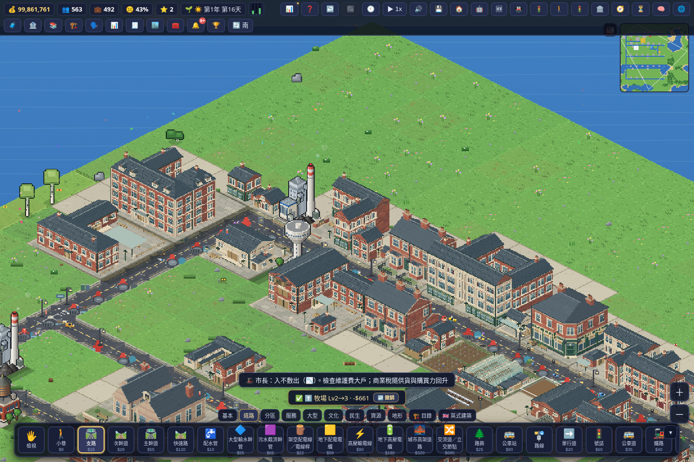

# 重建候選：中途真實遊戲畫面與狀態

此圖由 repo 原生 Chromium/CDP harness 擷取遊戲整個 viewport，非渲染示意圖。來源 candidate index SHA256 為 `8bb22b699d7af017f8e41a462c21e7f34362ab8e3ec220142d282a1f251762ed`。五份恢復美術原件保持原 SHA256；共享 kit 為明確標註的重建版。

拍攝於 2026-10-12 11:35:24 UTC，遊戲 day16、1440×960。背景／初始金錢與等級來自 repo 原有 QA seed；圖中三款新商店使用真原生工具付費建造。這是中途預覽，不是 36 款最終驗收畫面，也不構成上線確認。

第三次原生測試於 11:36:43 UTC 完成，122.321 秒，345/346 項通過，無瀏覽器 console error。兩格鐵路 (16,13)、(17,13) 已實際各收費40並建成，k166 聯運站在 (16,14) 成功原生放置。27 個直接／牧場付費 root 成功，9 款 RCI 曾自然取得；同一成熟畫面最多33，最後31，故36款共存仍失敗。不得把歷史聯集36當通過。

目前確切阻塞是 fixture 以 speed=0 只做 native step，警消車沒有正常 advance；低 RCI 後續犯罪、廢棄或火災，使共存失敗。下一次需用真付費 prison/fire 設施及普通 speed>0 的原生 advance，不得改需求、出生、災害或成熟條件。parent 要求先暫停新增驗收並回報，故未啟動第四次測試。

12:03:13 UTC 程序檢查：沒有在跑的測試、Chromium 或8199 server；只有先前已退出的 Chromium defunct 子程序。沒有工具等待或權限拒絕。保存所有 01/02/03 失敗。新圖確認、完整存讀／方向日夜季節／smoke／candidate fp／性能測試仍未完成。

main 保持54ecba5，未合併、未部署、未開 PR。此分支遠端 index 仍是 main 原版；重建輸入已完整備份，可由 build script 產生本次本地整合 index。
